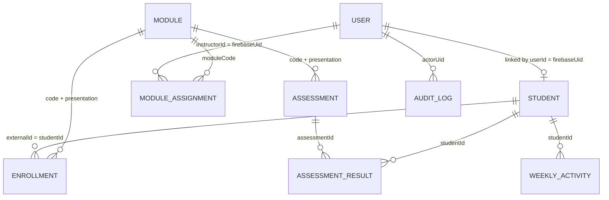

# Data Model

Two databases share one MongoDB instance (`student_prediction`). auth-service owns the `users` collection. data-service owns everything else. The services never write to each other's collections; cross-service data is requested over HTTP.

## Collections

### users (auth-service)

| Field | Type | Notes |
|---|---|---|
| `firebaseUid` | String, unique, sparse | Firebase UID. Legacy rows may lack it until migrated. |
| `name` | String, required | Up to 100 characters. |
| `email` | String, required, unique | Stored lowercase. |
| `role` | `student` \| `instructor` \| `admin` | Read only at profile creation, except through the admin role route. Admin accounts are never changed through the API. |
| `roleSelectionPending` | Boolean | True for social sign-ups that have not chosen a role yet. |
| `avatarUrl` | String | Optional, from the identity provider. |
| timestamps | Date | `createdAt`, `updatedAt` |

### students (data-service)

| Field | Type | Notes |
|---|---|---|
| `externalId` | Number, unique | The OULAD student ID. |
| `userId` | String, unique, sparse | Firebase UID of the linked login. Removed with `$unset` on unlink, because the sparse unique index does not allow `null`. |

### modules (data-service)

Key: `(code, presentation)`, unique. Fields: `code`, `presentation`, `lengthDays`.

### enrollments (data-service)

Key: `(studentId, moduleCode, presentation)`, unique.

| Field | Notes |
|---|---|
| `studentId` | OULAD student ID (refers to `students.externalId`). |
| `moduleCode`, `presentation` | Refers to `modules`. |
| `registeredDay`, `unregisteredDay` | Days relative to module start; may be null. |
| `ageBand`, `highestEducation` | Imported when present. |
| `prevAttempts`, `studiedCredits` | Numbers. |
| `finalResult` | Distinction, Pass, Fail or Withdrawn. Fail or Withdrawn drives the at-risk label. |

Gender, region, deprivation band and disability are deliberately not imported.

### assessments (data-service)

| Field | Notes |
|---|---|
| `assessmentId` | Unique. |
| `moduleCode`, `presentation` | Refers to `modules`. |
| `type` | TMA, CMA or Exam. |
| `dueDay` | Days since module start; null when the dataset has no date. |
| `weight` | Percent. |

### assessmentResults (data-service)

Key: `(studentId, assessmentId)`, unique. Fields: `score` (0 to 100), `submittedDay`, `isBanked`.

### weeklyActivity (data-service)

Key: `(studentId, moduleCode, presentation, week)`, unique. Fields: `week` (floor of day / 7; negative before the module started), `clicks`, `activeDays`. Aggregated from the daily click data during import.

### moduleAssignments (data-service)

Links an instructor to a module they may view.

| Field | Notes |
|---|---|
| `instructorId` | Firebase UID of an instructor account. |
| `moduleCode` | Module the instructor may access. |
| `assignedAt` | Creation time. |

Key: `(instructorId, moduleCode)`, unique. Removed when the instructor's role changes to anything other than instructor.

### audit_logs (data-service)

Append-only. The application never updates or deletes entries.

| Field | Used by | Notes |
|---|---|---|
| `action` | all | `demo_account.unlink` or `user.role_change`. |
| `actorUid`, `actorName` | all | The admin who performed the action. |
| `targetExternalId`, `previousUserId` | `demo_account.unlink` | The demo student and the login it was unlinked from. |
| `targetUid`, `targetName` | `user.role_change` | The account whose role changed. |
| `previousRole`, `newRole` | `user.role_change` | `student` or `instructor`. |
| `createdAt` | all | Immutable. |

## Relationships

## Indexes

Every collection listed above has the unique or lookup indexes described in its section. Audit entries are indexed by `createdAt`, by `targetExternalId` and by `targetUid`.
